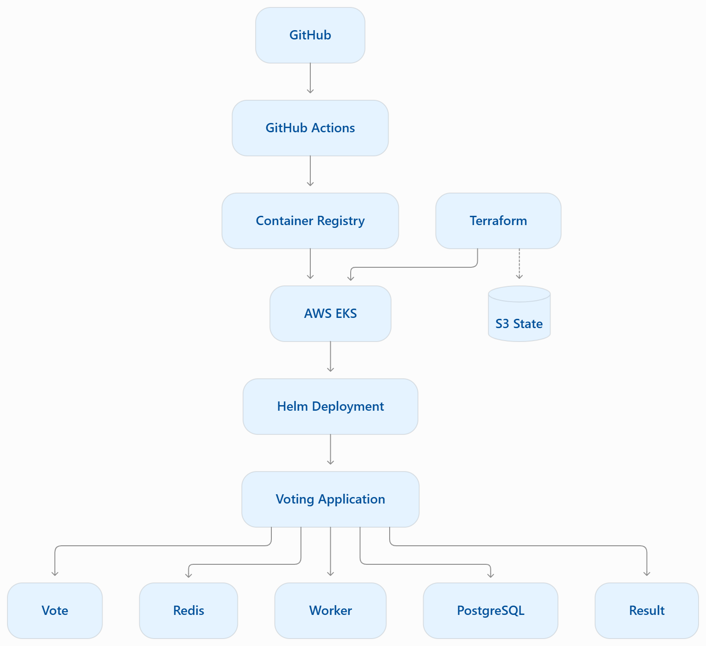
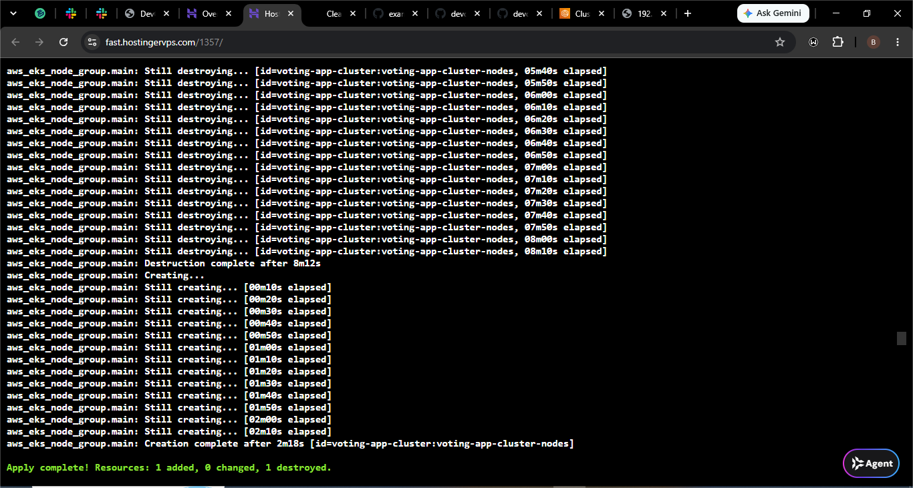
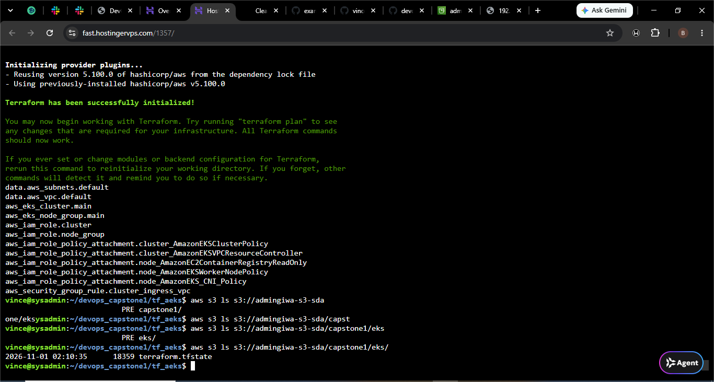
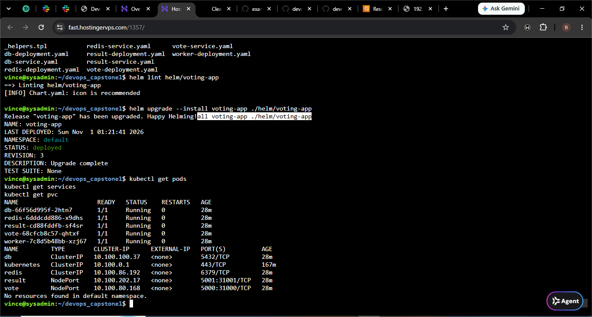
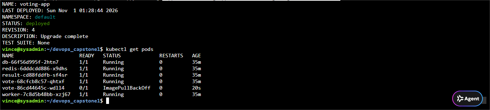
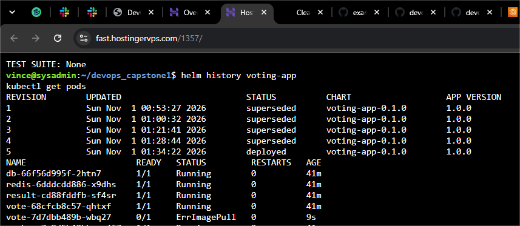
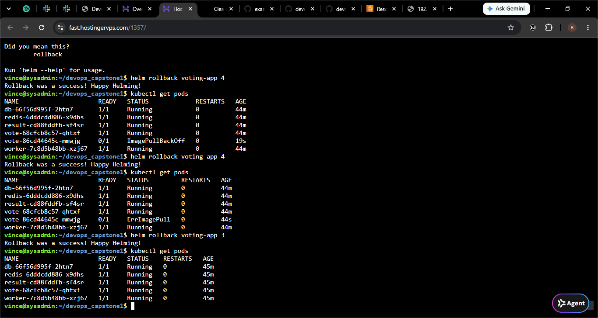

# Capstone 1 – End-to-End DevOps: Voting Application on Amazon EKS

## Project Overview

This project demonstrates an end-to-end DevOps workflow for deploying a distributed Voting Application to Amazon Elastic Kubernetes Service (EKS).

It covers local development with Docker Compose, secure containerization, infrastructure provisioning with Terraform, CI/CD automation using GitHub Actions, and Kubernetes deployment using Helm.

It also demonstrates how to intentionally introduce a failed deployment and recover the application using Helm rollback.

## Architecture

The architecture below illustrates the relationship between the source code, CI/CD pipeline, AWS infrastructure, container registry, and Kubernetes application.



## Technologies Used

- Docker and Docker Compose
- Kubernetes
- Amazon EKS
- Terraform
- Amazon S3
- GitHub Actions
- Trivy
- Helm
- Redis
- PostgreSQL
- Python
- Node.js
- .NET

## 1. Run the Application Locally

The project starts with a distributed Voting Application consisting of five services:

- **Vote:** Python frontend for submitting votes.
- **Redis:** Receives and queues votes.
- **Worker:** .NET service that processes votes.
- **PostgreSQL:** Stores voting results.
- **Result:** Node.js frontend that displays results.

Run the application locally:

```bash
docker compose up
```

The objective is to verify that the application works before moving into container orchestration.

## 2. Containerize the Application Safely

The application is containerized using Docker.

Security improvements include:

- Pinning base image versions.
- Running containers as non-root users.
- Using `.dockerignore` to exclude unnecessary files.
- Building and testing the application images.

## 3. Provision Kubernetes Infrastructure with Terraform

Terraform is used to provision the AWS infrastructure required for the Kubernetes deployment.

The Terraform configuration files are maintained in `tf_aeks/`.

The infrastructure was destroyed and recreated using Terraform, demonstrating Infrastructure as Code rather than relying on manual resource creation.

**EKS configuration:**

| Configuration | Value |
|---|---|
| Cluster name | voting-app-cluster |
| AWS Region | eu-north-1 |
| Kubernetes version | 1.31 |
| Worker nodes | 2 |

### Terraform Infrastructure Provisioning

The screenshot below shows Terraform destroying the previous EKS node group and creating it again from the configuration. The operation completed successfully.



### Terraform Remote State with Amazon S3

Terraform state was configured to use an S3 backend instead of relying solely on local state files.

The remote state is stored at:

- **Bucket:** `admingiwa-s3-sda`
- **Key:** `capstone1/eks/terraform.tfstate`
- **Region:** `eu-north-1`

This allows Terraform to retrieve the infrastructure state from S3 when working from the configured backend.

The screenshot below shows the Terraform state file stored in the S3 bucket.



## 4. Automate with GitHub Actions

GitHub Actions is used to automate the CI/CD workflow.

The pipeline stages include:

1. Run application tests.
2. Scan images and dependencies using Trivy.
3. Build Docker images.
4. Push images to the container registry.
5. Tag images using the Git commit SHA.

This creates a repeatable workflow for building and publishing application images.

## 5. Deploy the Application with Helm

A custom Helm chart is used to deploy the Voting Application to Amazon EKS.

First, validate the chart:

```bash
helm lint ./helm/voting-app
```

Deploy the application:

```bash
helm upgrade --install voting-app ./helm/voting-app
```

Verify the deployment:

```bash
kubectl get pods
kubectl get services
kubectl get deployments
helm status voting-app
```

The application exposes two frontend services through Kubernetes NodePort:

| Application | NodePort |
|---|---:|
| Vote | 31000 |
| Result | 31001 |

### Successful Deployment

The screenshot below shows the Helm chart validation, successful release deployment, five running application Pods, and the Kubernetes Services.



## 6. Simulate a Failed Helm Release

To test deployment failure and recovery, an intentionally invalid image tag was deployed for the Vote application.

```bash
helm upgrade voting-app ./helm/voting-app \
  --set vote.image.tag=bad-release-test
```

This created a new Helm release revision.

### Inspect Helm Release History

```bash
helm history voting-app
```

The screenshot below shows the Helm release history after the bad upgrade, including the new release revision.



### Observe the Image Pull Failure

```bash
kubectl get pods
```

The new Vote Pod entered `ImagePullBackOff` because Kubernetes could not pull the invalid image.

The existing Vote Pod remained running while Kubernetes attempted to perform the rolling update.



This demonstrated how Kubernetes handles an unsuccessful rolling update while the previous working Pod is still available.

## 7. Recover the Application Using Helm Rollback

After confirming the failure, the application was rolled back to a previous working revision.

```bash
helm rollback voting-app 3
```

### Verify Application Recovery

```bash
kubectl get pods
helm history voting-app
```

The rollback restored the previous working configuration. All five application components returned to a `Running` state.

The screenshot below shows the rollback operation and the recovered application.



This exercise demonstrated:

- Helm release history and revisions.
- Failed application upgrades.
- Kubernetes rolling updates.
- Image pull failures.
- Restoring a previous working release.
- Application recovery without reinstalling the entire application.

## Project Outcome

Successfully provisioned AWS infrastructure using Terraform, configured remote state storage with Amazon S3, and deployed a distributed Voting Application to Amazon EKS using Helm.

The project provided practical experience with:

- Docker containerization.
- Infrastructure as Code.
- AWS EKS cluster management.
- Terraform remote state.
- CI/CD automation concepts.
- Container security scanning.
- Kubernetes deployments and services.
- Helm chart management.
- Deployment troubleshooting and rollback strategies.

## Cleanup

Remove the Helm release:

```bash
helm uninstall voting-app
```

To destroy the Terraform-managed infrastructure, navigate to the Terraform directory:

```bash
cd tf_aeks
terraform plan -destroy
terraform destroy
```

Review the destruction plan carefully before confirming.
